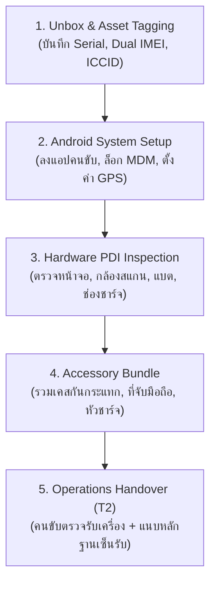

# คู่มือและข้อเสนอแนะการบริหารจัดการโทรศัพท์และระบบซิมการ์ดสำหรับงานขนส่ง (Fleet Phone & SIM Management Guide)

> **เอกสารฉบับนี้จัดทำขึ้นสำหรับ:** ทีมพัฒนาและผู้ดูแลระบบ `phone-asset-mgr` (FLS Transport) เพื่อใช้เป็นแนวทางอ้างอิงเชิงลึก (Best Practices & Architecture Recommendations) ในการออกแบบระบบส่งมอบโทรศัพท์และซิมการ์ดให้กับฝ่าย Operations และพนักงานขับรถขนส่ง (Drivers) รวมถึงให้ AI/Claude สามารถศึกษาต่อยอดได้ทันที

---

## สารบัญ (Table of Contents)
1. [ภาพรวมและปรัชญาการออกแบบ (System Overview & Philosophy)](#1-ภาพรวมและปรัชญาการออกแบบ)
2. [ระบบซิมการ์ดและเครือข่ายโทรคมนาคมองค์กร (Corporate SIM & Cellular Network)](#2-ระบบซิมการ์ดและเครือข่ายโทรคมนาคมองค์กร)
3. [ข้อมูลการแกะกล่องและฮาร์ดแวร์ตัวเครื่อง (Unboxing & Android Hardware Specs)](#3-ข้อมูลการแกะกล่องและฮาร์ดแวร์ตัวเครื่อง)
4. [อุปกรณ์เสริมสำหรับงานขนส่ง (In-Box vs. Driver Fleet Accessories)](#4-อุปกรณ์เสริมสำหรับงานขนส่ง)
5. [ขั้นตอนการตรวจรับและส่งมอบ (Pre-Delivery Inspection & Handover Protocol)](#5-ขั้นตอนการตรวจรับและส่งมอบ)
6. [แนวทางการปรับปรุงสถาปัตยกรรมระบบ (System Architecture & Code Recommendations)](#6-แนวทางการปรับปรุงสถาปัตยกรรมระบบ)

---

## 1. ภาพรวมและปรัชญาการออกแบบ

ในงานโลจิสติกส์และการกระจายสินค้า (Logistics & Last-Mile Delivery) **"โทรศัพท์มือถือ" ไม่ได้ทำหน้าที่เพียงแค่โทรติดต่อ** แต่เป็น **"สถานีทำงานเคลื่อนที่ (Mobile Workstation)"** ของคนขับรถ ซึ่งต้องรองรับ:
- การรับ-ส่งงานผ่านแอปคนขับ (Driver/TMS App)
- การนำทางผ่านระบบ GPS แบบ Real-time ตลอดทั้งวัน
- การสแกนบาร์โค้ดพัสดุและถ่ายภาพหลักฐานการจัดส่ง (Proof of Delivery - POD)
- การพิมพ์ใบเสร็จผ่านเครื่องพิมพ์พกพาไร้สาย (Bluetooth Mobile Printer)

### กฎสำคัญ: วงจรชีวิตของเครื่อง (Device Lifecycle) $\neq$ วงจรชีวิตของซิม (SIM Lifecycle)
ในทางปฏิบัติ เครื่องและซิมไม่ได้ผูกติดกันตลอดไป:
1. **เครื่องเสีย/หน้าจอแตก:** ตัวเครื่องต้องถูกส่งซ่อมหรือเปลี่ยนเครื่องใหม่ (T3 Swap) แต่คนขับสามารถถอดซิมเดิมไปใส่เครื่องสำรองเพื่อวิ่งงานต่อได้ทันที
2. **ซิมหาย/ซิมชำรุด:** ซิมอาจพังหรือสัญญาณหาย แต่เครื่องยังใช้งานได้ปกติ โดยฝ่าย IT/Admin จะออกซิมใหม่เบอร์เดิม
3. **คนขับลาออก:** ต้องส่งคืนทั้งเครื่อง อุปกรณ์เสริม และซิมการ์ด เพื่อนำไป Reset และจ่ายให้คนขับท่านอื่นต่อไป

---

## 2. ระบบซิมการ์ดและเครือข่ายโทรคมนาคมองค์กร

การบริหารซิมการ์ดในระดับ Fleet แตกต่างจากซิมส่วนบุคคลอย่างมาก โดยมีประเด็นสำคัญที่ระบบควรบันทึกและควบคุมดังนี้:

### 2.1 ข้อมูลระบุตัวตนทางเทคนิคของ SIM (Telecom Identifiers)

| ข้อมูล (Field) | ตัวอย่างค่า | ความสำคัญและวิธีใช้งาน |
| :--- | :--- | :--- |
| **ICCID (SIM Serial Number)** | `8966 0001 2345 6789 012` (19-20 หลัก) | **รหัสระบุตัวตนชิปซิมทั่วโลก** พิมพ์อยู่บนแผ่นซิมการ์ดและซองใส่ซิม สำคัญที่สุดเวลาติดต่อโอเปอเรเตอร์เพื่อระงับสัญญาณ, ออกซิมใหม่, หรือย้ายแพ็กเกจ (สามารถสแกนบาร์โค้ดได้) |
| **MSISDN (Phone Number)** | `081-234-5678` | หมายเลขโทรศัพท์ที่คนขับใช้ติดต่อลูกค้าปลายทาง และใช้เป็นเบอร์ลงทะเบียนในระบบจัดส่ง |
| **IMSI (International Mobile Subscriber Identity)** | `52003...` (15 หลัก) | รหัสสมาชิกเครือข่าย (ใช้ในระดับระบบเครือข่ายโอเปอเรเตอร์) |
| **PUK Code (PUK1)** | `84729103` (8 หลัก) | **วิกฤตมากสำหรับฝ่าย IT:** หากคนขับกด PIN ผิดเกิน 3 ครั้ง ซิมจะถูกล็อก (PUK Locked) หาก IT มีบันทึก PUK Code ในระบบ จะสามารถแจ้งคนขับปลดล็อกได้ทันทีภายใน 1 นาที โดยไม่ต้องวิ่งไปศูนย์บริการ |
| **Carrier / Operator** | `AIS`, `True`, `DTAC`, `NT` | เครือข่ายที่ให้บริการ เพื่อทราบว่าต้องติดต่อ Call Center ฝ่ายองค์กรของค่ายใด |
| **SIM Type / Form Factor** | `Physical Nano SIM`, `eSIM` | ปัจจุบันสมาร์ตโฟนขนส่งส่วนใหญ่ใช้ Physical Nano SIM แต่ระบบควรเปิดช่องรองรับ eSIM (บันทึกคู่กับ EID) |

---

### 2.2 การจัดการแพ็กเกจอินเทอร์เน็ตและค่าบริการ (Data Plans & Corporate Pooling)

องค์กรขนส่งส่วนใหญ่มักทำสัญญานิติบุคคล (Corporate Contract) ร่วมกับโอเปอเรเตอร์ โดยมีรูปแบบแพ็กเกจหลัก 3 แบบ:
1. **Shared Corporate Data Pool:** ซื้อปริมาณดาต้ารวม เช่น 500GB สำหรับคนขับ 100 คน (เฉลี่ย 5GB/คน) ช่วยเกลี่ยคนที่ใช้น้อยกับคนที่ใช้มาก ไม่เกิดค่าบริการส่วนเกิน
2. **Fixed Speed Unlimited:** เช่น ความเร็วคงที่ 10 Mbps หรือ 15 Mbps ไม่อั้น ไม่ลดสปีด (เป็นรูปแบบที่แนะนำสำหรับงานส่งของ เพราะ 10-15 Mbps เพียงพอสำหรับ GPS, สแกนพัสดุ และอัปโหลดรูป POD แต่ป้องกันไม่ให้เน็ตเร็วเกินไปจนคนขับโหลดไฟล์หนังขนาดใหญ่)
3. **Data Capped + FUP:** กำหนดให้ 15GB ต่อเดือน หากเกินจะลดความเร็วเหลือ 384 kbps

**ฟิลด์ที่ควรบันทึกเพิ่มเติม:**
- `Billing Account No.` / `Cost Center`: สำหรับกระจายค่าใช้จ่ายไปยังสาขาหรือ Site ต่างๆ
- `Data Renewal Date`: วันตัดรอบบิลและต่ออายุแพ็กเกจ

---

### 2.3 ความปลอดภัยและการควบคุมระบบเครือข่าย (Network Governance & Security)

ในสภาพแวดล้อมจริง มักพบปัญหาคนขับนำซิมบริษัทที่มีเน็ตไม่อั้นไปใส่เครื่องส่วนตัวเพื่อเล่นเกม/ดูหนัง หรือเปิด Hotspot ให้เพื่อน จึงควรมีมาตรการควบคุม:

1. **IMEI-SIM Locking (Carrier / MDM Level):**
   - การผูกเบอร์หรือ ICCID เข้ากับหมายเลข IMEI เครื่องอย่างเป็นทางการ
   - หากตรวจพบว่าซิมถูกถอดไปใส่เครื่องอื่น ระบบเครือข่ายจะตัดสัญญาณเน็ตทันที หรือระบบ MDM จะส่ง Alert แจ้งเตือนฝ่าย IT
2. **Private APN (Corporate APN) vs. Public APN:**
   - *Public APN:* ซิมจะวิ่งออกอินเทอร์เน็ตสาธารณะตรงๆ
   - *Private APN:* ทราฟฟิกข้อมูลของคนขับจะวิ่งผ่านช่องทางเสมือน (VPN Tunnel / MPLS) ตรงเข้าสู่อุโมงค์เซิร์ฟเวอร์ของบริษัทก่อน เพิ่มความปลอดภัยสูงสุด และสามารถทำ URL/Domain Whitelist ได้
3. **การบล็อก Wi-Fi Hotspot / Tethering:**
   - สั่งบล็อกการแชร์เน็ตผ่าน MDM Policy หรือตั้งค่าโปรไฟล์ของซิม เพื่อประหยัด Bandwidth และป้องกันการใช้งานผิดวัตถุประสงค์
4. **การบล็อก Content & Streaming:**
   - ตั้งค่าผ่าน DNS / Firewall ขององค์กรหรือ MDM เพื่อบล็อกเว็บไซต์บันเทิง (YouTube, TikTok, เว็บการพนัน, บริการสตรีมมิ่ง)
5. **Border Data Roaming Protection (การป้องกันโรมมิ่งข้ามพรมแดน):**
   - สำหรับสาขาที่อยู่ใกล้ชายแดน (เช่น แม่สอด, อรัญประเทศ, มุกดาหาร, สุไหงโก-ลก) ต้องตั้งค่า **"Disable International Roaming"** ไว้เสมอ ป้องกันไม่ให้ซิมไปจับสัญญาณเสาประเทศเพื่อนบ้าน ซึ่งจะทำให้เกิดบิลค่าบริการโรมมิ่งมหาศาล

---

## 3. ข้อมูลการแกะกล่องและฮาร์ดแวร์ตัวเครื่อง (Unboxing & Android Hardware)

เมื่อฝ่ายจัดซื้อรับมอบเครื่องล็อตใหม่เข้ามา ข้อมูลบนกล่องและภายในเครื่องจะต้องถูกตรวจสอบอย่างละเอียด:

### 3.1 ข้อมูลบนสติกเกอร์ข้างกล่อง / หลังกล่อง (Box Label & Packaging)

```
┌────────────────────────────────────────────────────────┐
│  SAMSUNG GALAXY A16 (LTE)                              │
│  Model: SM-A165FZKDTHL        Color: Black             │
│  RAM/ROM: 6GB / 128GB                                  │
│                                                        │
│  S/N: R58X90ABCDE                                      │
│  ||||||||||||||||||||||||||||||||||||||||||||||||||||| │
│  IMEI 1: 356987110123456                               │
│  ||||||||||||||||||||||||||||||||||||||||||||||||||||| │
│  IMEI 2: 356987110123464                               │
│  ||||||||||||||||||||||||||||||||||||||||||||||||||||| │
│  EAN Barcode: 8806095123456                            │
│  MFD: 2024.08.15        Made in Vietnam                │
│  Distributor: Synnex Thailand                          │
└────────────────────────────────────────────────────────┘
```

1. **Exact Model Code / Part Number:** เช่น `SM-A165FZKDTHL` (ระบุรหัสสี สเปก และ THL แสดงถึงรหัสศูนย์ไทย)
2. **Dual IMEI (IMEI 1 & IMEI 2):** โทรศัพท์ Android สเปกสำหรับองค์กรเกือบทั้งหมดเป็นแบบ 2 ซิม ควรบันทึกทั้งสองหมายเลข และกำหนดว่าซิมบริษัทอยู่ใน Slot 1 หรือ Slot 2
3. **Distributor / Warranty Sticker:** เช่น สติกเกอร์ Synnex, SiS, VST ECS, Jaymart, True, AIS เพื่อความรวดเร็วในการส่งซ่อมเคลมประกัน ไม่ต้องเสียเวลาค้นหาใบเสร็จ
4. **วันที่ผลิต (MFD):** ใช้ตรวจสอบอายุแบตเตอรี่ที่ค้างสต็อกก่อนการเปิดใช้งาน
5. **EAN-13 / UPC Barcode:** บาร์โค้ดมาตรฐานสากล ใช้ยิงสแกนรับของเข้าคลังพัสดุ
6. **เลขอ้างอิงการจัดซื้อ:** PO Number, Tax Invoice No., Batch/Lot No.

---

### 3.2 ข้อมูลระบบ Android และฮาร์ดแวร์ภายใน

1. **RAM Capacity (หน่วยความจำแรม):** สำคัญอย่างยิ่งต่อความลื่นไหล คนขับต้องเปิดแอปนำทาง (Google Maps) ซ้อนกับแอปคนขับ และสลับมาเปิดกล้องถ่ายรูป หาก RAM ต่ำกว่า 4GB เครื่องจะค้างหรือปิดแอปเบื้องหลังบ่อยครั้ง
2. **Storage Capacity (ROM):** สำหรับเก็บข้อมูลออฟไลน์ แคชแผนที่ และรูปภาพ POD ก่อนอัปโหลด
3. **Bluetooth MAC Address:**
   - **ทำไมต้องเก็บ?** เพราะคนขับสายขนส่งสินค้ามักต้องพกพา **เครื่องพิมพ์สลิปไร้สาย (Mobile Thermal Printer)** สำหรับพิมพ์ใบรับของ หรือใช้เครื่องยิงสแกนบาร์โค้ดไร้สายภายนอก การบันทึก Bluetooth MAC จะช่วยให้ IT กำหนดค่าจับคู่อุปกรณ์ล่วงหน้าได้
4. **Wi-Fi MAC Address:** สำหรับตั้งค่า Whitelist ให้เข้าเกาะ Wi-Fi คลังสินค้า/Hub ได้อัตโนมัติเมื่อกลับมาถึงจุดพัก
5. **การตั้งค่านโยบาย Android สเปกขนส่ง:**
   - **Location Permission:** ต้องตั้งค่าเป็น `Allow all the time` (อนุญาตตลอดเวลา)
   - **Mock Location Setting:** ต้องตรวจสอบว่าปิด (Off) และล็อก Developer Options ไว้ เพื่อป้องกันการใช้แอปโกงตำแหน่ง GPS
   - **Battery Optimization:** ต้องยกเว้น (Disable Optimization) สำหรับแอปคนขับ เพื่อไม่ให้ระบบ Android บังคับปิดแอปขณะขับรถ
   - **Kiosk / MDM Mode:** ล็อกไม่ให้คนขับติดตั้งเกมนอกเหนือจากงาน หรือเปิด Play Store ส่วนตัว

---

## 4. อุปกรณ์เสริมสำหรับงานขนส่ง (In-Box vs. Driver Fleet Accessories)

### 4.1 ตรวจสอบอุปกรณ์ในกล่อง (In-Box Items Checklist)
เมื่อแกะกล่อง สิ่งที่ต้องบันทึกว่าได้รับครบหรือไม่:
- [ ] ตัวเครื่องสมาร์ตโฟน (Handset)
- [ ] ฟิล์มกันรอยที่ติดมาจากโรงงาน (ถ้ามี)
- [ ] สายชาร์จ (Charging Cable) - ระบุชนิด Type-C to Type-C หรือ Type-A to Type-C
- [ ] **หัวชาร์จ (Power Adapter):** *โทรศัพท์ยุคใหม่หลายรุ่นไม่ได้แถมหัวชาร์จมาในกล่อง หากบริษัทต้องจัดซื้อแยก ต้องบันทึกว่าใช้รุ่นกี่ Watt (เช่น 15W / 25W Fast Charge)*
- [ ] เข็มจิ้มถาดซิมการ์ด (SIM Ejector Pin)
- [ ] เคสใสมาตรฐานจากโรงงาน (ถ้ามีแถม)
- [ ] เอกสารคู่มือและใบรับประกัน

### 4.2 ชุดอุปกรณ์เฉพาะสำหรับคนขับ (Driver Operational Kit)
อุปกรณ์ที่ฝ่าย Operations ต้องจัดเพิ่มเพื่อการส่งมอบให้กับ Driver:
- [ ] **SIM Card บริษัท:** พร้อมแพ็กเกจเน็ต (บันทึกเบอร์และ ICCID)
- [ ] **ขาจับมือถือติดยานพาหนะ (Vehicle / Motorcycle Mount):**
  - สำหรับมอเตอร์ไซค์: แนะนำแบบมีระบบ **ซับแรงสั่นสะเทือน (Vibration Dampener)** เพื่อป้องกันระบบกันสั่นของเลนส์กล้องมือถือเสียหายจากแรงสั่นของเครื่องยนต์
  - สำหรับรถกระบะ/รถตู้: ขาจับแบบดูดกระจกหรือหนีบช่องแอร์แบบแข็งแรงพิเศษ
- [ ] **เคสกันกระแทกเกรดทหาร (Rugged / Heavy-duty Shockproof Case):** พร้อมห่วงคล้องนิ้ว หรือสายคล้องคอ/คล้องมือกันเครื่องร่วงหล่นขณะยกของ
- [ ] **กระจกนิรภัยกันรอย (Tempered Glass 9H):** ป้องกันหน้าจอแตก
- [ ] **อุปกรณ์ชาร์จในยานพาหนะ (Car Charger / Moto USB Charger):** หรือแบตเตอรี่สำรอง (Power Bank) สำหรับกรณีฉุกเฉิน
- [ ] **หมวกบังแดด/กันฝนสำหรับมือถือ (Sun & Rain Visor):** ป้องกันความร้อนสะสมทำให้มือถือตัดการทำงานเมื่อตากแดดจัด

---

## 5. ขั้นตอนการตรวจรับและส่งมอบ (Pre-Delivery Inspection & Handover Protocol)

ก่อนส่งมอบให้คนขับลงชื่อรับมอบในหน้า `hand-out` ควรมีขั้นตอนการตรวจสอบสภาพ (PDI Checklist) 6 ขั้นตอน:



### รายละเอียดการตรวจ 6 จุดสำคัญ (PDI Checklist):
1. **หน้าจอสัมผัส (Touchscreen):** ตรวจสอบการทัชทั่วทั้งแผ่นจอ ไม่มีรอยร้าว ไม่มีจุดบอด
2. **กล้องหน้าและหลัง (Camera & Barcode Scanner):** ต้องโฟกัสเร็ว ถ่ายภาพใบเสร็จ/พัสดุได้ชัดเจนทั้งกลางวันและที่แสงน้อย
3. **ระบบระบุพิกัดดาวเทียม (GPS Precision):** เปิดทดสอบจับพิกัดนอกอาคาร ต้องระบุตำแหน่งได้แม่นยำภายในรัศมี 5-10 เมตร ไม่หลุด
4. **พอร์ตชาร์จและแบตเตอรี่ (Charging Port & Battery):** เสียบสายชาร์จแน่น ไม่หลวม รองรับ Fast Charging แบตเตอรี่ไม่บวม
5. **ลำโพงและไมโครโฟน (Audio & Mic):** ทดสอบโทรเข้า-ออก เพื่อให้แน่ใจว่าได้ยินเสียงลูกค้าและลูกค้าได้ยินเสียงคนขับชัดเจนท่ามกลางเสียงจราจร
6. **การเชื่อมต่อเครือข่ายมือถือ (Cellular Data):** ทดสอบเปิดปิดโหมดเครื่องบิน สัญญาณ 4G/5G กลับมาจับคู่ได้เร็ว ปิดการเชื่อมต่อส่วนตัว

---

## 6. แนวทางการปรับปรุงสถาปัตยกรรมระบบ (System Architecture & Code Recommendations)

### 6.1 ข้อแนะนำการออกแบบ Data Model สำหรับ SIM Card

ในระบบปัจจุบัน SIM ถูกมองเป็นเพียง Accessory ชิ้นหนึ่ง (`AccessoryKey = "sim"`) และเก็บหมายเลขโทรศัพท์เป็น String ในตัวเครื่อง (`Device.phoneNumber`)

**ข้อแนะนำสำหรับระยะยาว (Enterprise Fleet):**
ควรออกแบบให้ **SIM Card เป็น Asset Entity อิสระ** เช่นเดียวกับ Device โดยมีความสัมพันธ์แบบ 1:1 กับ Device เมื่อถูกประกอบร่าง:

```typescript
// โมเดลโครงสร้างข้อมูลซิมการ์ดแนะนำ (Suggested SimCard Entity)
export interface SimCard {
  id: string;
  iccid: string;                 // เลข Serial หลังซิม 19-20 หลัก (Unique)
  phoneNumber: string;           // เบอร์โทรศัพท์ (MSISDN)
  carrier: "AIS" | "TRUE" | "DTAC" | "NT" | "OTHER";
  planType: string;              // เช่น "Corporate 10Mbps Unlimited", "Pool 500GB"
  puk1?: string;                 // PUK Code สำหรับปลดล็อกฉุกเฉิน
  status: "in_stock" | "assigned" | "suspended" | "retired";
  currentDeviceId?: string | null;  // กำลังเสียบอยู่ที่เครื่องไหน (ผูกกับ Device.id)
  currentSiteId: string;
  activatedAt?: string;
  expiresAt?: string;
}
```

---

### 6.2 การปรับปรุง `DEVICE_FIELD_CATALOG` ใน `lib/device-model-fields.ts`

ในหน้า `admin/models/new/page.tsx` สามารถเพิ่มหมวดหมู่ของ Checkbox เพื่อให้ Admin ติ๊กเลือกเก็บข้อมูลตามรุ่นโทรศัพท์ได้อย่างยืดหยุ่น:

```typescript
export const DEVICE_FIELD_CATALOG: DeviceFieldOption[] = [
  // --- 1. ข้อมูลการซื้อและการ Unbox (Procurement & Unboxing) ---
  { key: "fullModelCode", label: "Model Code เต็มข้างกล่อง (SKU)", inputType: "text", placeholder: "เช่น SM-A165FZKDTHL" },
  { key: "color", label: "Color", inputType: "text", placeholder: "เช่น Midnight Black" },
  { key: "distributor", label: "ตัวแทนจำหน่าย/ศูนย์ประกัน", inputType: "select", options: ["Synnex", "SiS", "VST ECS", "Jaymart", "TG Fone", "AIS Business", "True Business", "อื่นๆ"] },
  { key: "mfdDate", label: "วันที่ผลิตข้างกล่อง (MFD)", inputType: "date" },
  { key: "poNumber", label: "PO / เลขที่ใบสั่งซื้อ", inputType: "text", placeholder: "PO-2024-XXXX" },
  { key: "purchaseDate", label: "Purchase date", inputType: "date" },
  { key: "warrantyExpiry", label: "Warranty expiry", inputType: "date" },
  { key: "assetTag", label: "Asset tag / barcode องค์กร", inputType: "text", placeholder: "AST-FLS-XXXX" },

  // --- 2. สเปกระบบ Android และการเชื่อมต่อ (Android Hardware & Network) ---
  { key: "ramCapacity", label: "RAM (หน่วยความจำแรม)", inputType: "select", options: ["3GB", "4GB", "6GB", "8GB", "12GB"] },
  { key: "storageCapacity", label: "Storage capacity (ROM)", inputType: "select", options: ["32GB", "64GB", "128GB", "256GB", "512GB"] },
  { key: "androidVersion", label: "Android OS Version", inputType: "text", placeholder: "เช่น Android 14 (One UI 6.1)" },
  { key: "imei2", label: "IMEI 2 (สำหรับ Dual-SIM)", inputType: "text", placeholder: "15 หลัก" },
  { key: "eid", label: "EID (สำหรับ eSIM)", inputType: "text", placeholder: "32 หลัก" },
  { key: "macAddress", label: "Wi-Fi MAC address", inputType: "text", placeholder: "AA:BB:CC:DD:EE:FF" },
  { key: "bluetoothMac", label: "Bluetooth MAC (สำหรับปริ้นเตอร์พกพา)", inputType: "text", placeholder: "AA:BB:CC:DD:EE:FF" },

  // --- 3. ข้อมูลซิมการ์ดและเครือข่าย (SIM & Carrier Details) ---
  { key: "simIccid", label: "SIM Serial (ICCID หลังซิม 19-20 หลัก)", inputType: "text", placeholder: "8966..." },
  { key: "simCarrier", label: "เครือข่ายซิมการ์ด", inputType: "select", options: ["AIS", "TRUE", "DTAC", "NT", "อื่นๆ"] },
  { key: "simPukCode", label: "PUK Code (สำหรับปลดล็อกซิม)", inputType: "text", placeholder: "8 หลัก" },
  { key: "simPlanName", label: "แพ็กเกจเน็ต / Data Plan", inputType: "text", placeholder: "เช่น Unlimited 10Mbps หรือ Pool" },

  // --- 4. อุปกรณ์ส่งมอบให้คนขับ (Fleet Accessories) ---
  { key: "chargerType", label: "หัวชาร์จที่จัดให้", inputType: "select", options: ["แถมมาในกล่องเดิม", "จัดซื้อเพิ่ม 15W", "จัดซื้อเพิ่ม 25W Fast Charge", "ไม่มีหัวชาร์จ"] },
  { key: "mountType", label: "ประเภทที่จับมือถือติดรถ", inputType: "select", options: ["มอเตอร์ไซค์ (ก้านกระจก)", "มอเตอร์ไซค์ (แฮนด์บาร์)", "รถยนต์ (ดูดกระจก)", "รถยนต์ (หนีบช่องแอร์)"] },
  { key: "hasScreenProtector", label: "ติดฟิล์มกระจกแล้ว", inputType: "select", options: ["ใช่ (ติดแล้ว)", "ไม่ใช่ (ยังไม่ติด)"] }
];
```

---

### 6.3 การขยาย `AccessoryKey` ใน `types/index.ts` และ `lib/codes.ts`

ขยายรายการอุปกรณ์ที่ส่งมอบให้ Drivers ในหน้า `hand-out` และ `take-back`:

```typescript
// ใน types/index.ts
export type AccessoryKey =
  | "charger"         // หัวชาร์จ
  | "cable"           // สายชาร์จ
  | "case"            // เคสกันกระแทก
  | "mount"           // ที่จับมือถือติดรถ
  | "sim"             // ซิมการ์ด
  | "temperedGlass"   // ฟิล์มกระจกนิรภัย
  | "rainCover"       // หมวก/ถุงกันน้ำกันแดด
  | "simPin";         // เข็มจิ้มซิม
```

---

## สรุปภาพรวม (Key Takeaways)

1. **อย่ามองข้าม SIM และ PUK Code:** การเก็บเลข ICCID และ PUK Code ช่วยประหยัดเวลาและค่าใช้จ่ายของฝ่าย IT และลด Downtime ของคนขับได้มหาศาล
2. **คุมเรื่องการขโมยเน็ตและหลุดโฟกัส:** ใช้ IMEI-SIM Binding และ MDM ป้องกันการถอดซิมไปเล่นเกม และล็อกไม่ให้เปิด Hotspot
3. **ฮาร์ดแวร์ข้างกล่อง:** เก็บ SKU เต็ม, Distributor Label (Synnex/SiS) และ Dual IMEI เสมอเพื่อความสะดวกรวดเร็วในการส่งเคลมประกัน
4. **ความทนทานหน้างาน:** อุปกรณ์จับมือถือควรมีระบบกันสั่น (Anti-vibration) และควรมีเคสกันกระแทกพร้อมฟิล์มกระจกเป็นอุปกรณ์มาตรฐานประจำตัวคนขับ
